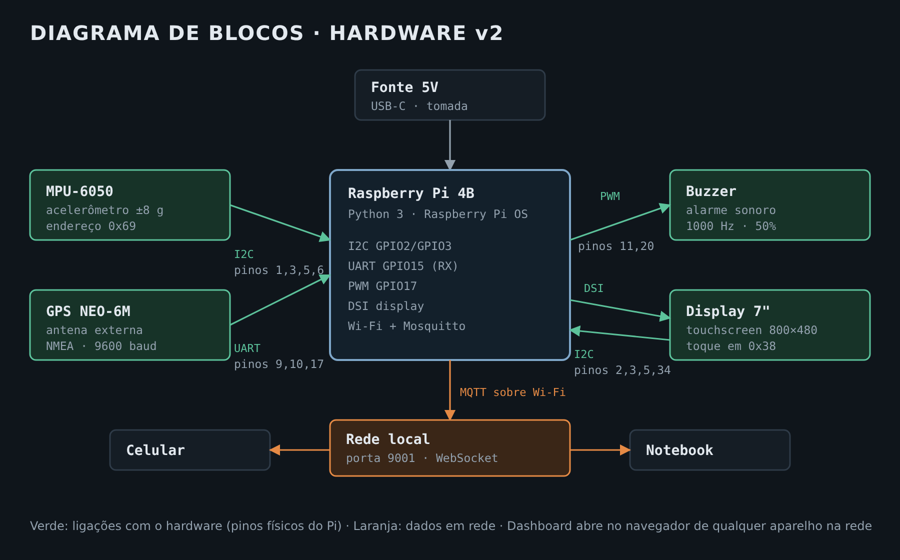
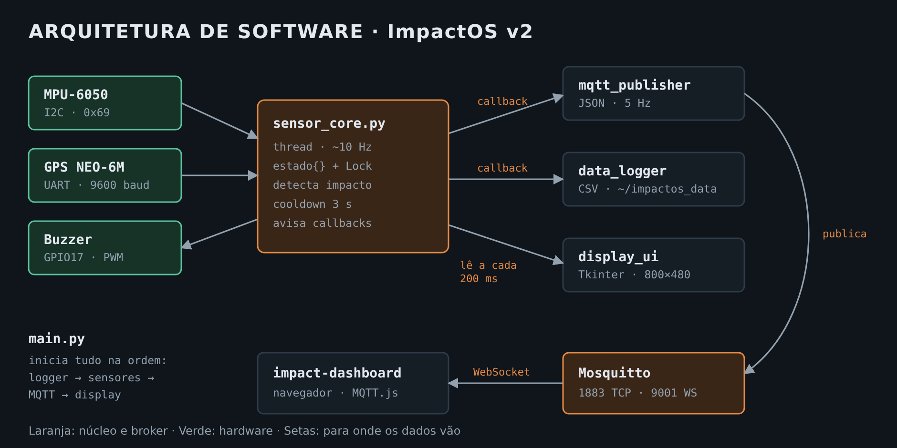

# ImpactOS Monitor

Sistema embarcado de detecção e monitoramento de impactos em tempo real.

📹 **Vídeos de demonstração:**
- v2 (Raspberry Pi 4 + MQTT): https://youtu.be/zHPBC74D3vM
- v1 (Raspberry Pi Pico + Bluetooth): https://youtu.be/grMOWIprhys

---

## Índice

- [Sobre o Projeto](#sobre-o-projeto)
- [Versão 2 — Atual](#versão-2--atual-raspberry-pi-4--mqtt)
- [Versão 1 — Origem](#versão-1--origem-raspberry-pi-pico--bluetooth)
- [Evolução do Projeto](#evolução-do-projeto)
- [Licença](#licença)

---

## Sobre o Projeto

O ImpactOS é um sistema de monitoramento contínuo de aceleração que detecta impactos acima de um limite configurado, registra a localização GPS do evento e transmite os dados em tempo real para um dashboard web. Ao detectar um impacto, o sistema:

- Captura a força do impacto em G (múltiplos da gravidade) nos três eixos X, Y e Z
- Registra as coordenadas GPS do momento do evento
- Transmite os dados via rede para o dashboard web
- Aciona um alarme sonoro com o buzzer
- Exibe o status em tempo real no display touchscreen

---

## Versão 2 — Atual (Raspberry Pi 4 + MQTT)

### Hardware

| Componente | Modelo | Função |
|---|---|---|
| Microcontrolador | Raspberry Pi 4B (8GB) | Processamento central |
| Display | Raspberry Pi 7" Touchscreen | Interface de configuração |
| Acelerômetro | MPU-6050 (GY-521) | Leitura de aceleração ±8G |
| GPS | GY-NEO6MV2 (NEO-6M) | Localização com antena externa |
| Buzzer | Buzzer ativo | Alarme sonoro |
| Alimentação | Fonte 5V USB-C | Alimentação do Pi 4 |

### Diagrama de blocos



### Pinagem — Pi 4B

| Pino Físico | GPIO | Periférico | Função |
|---|---|---|---|
| 1 | 3V3 | MPU-6050 | VCC + AD0 (endereço I2C 0x69) |
| 2 | 5V | Display | VCC |
| 3 | GPIO2 | MPU-6050 + Display | I2C SDA |
| 5 | GPIO3 | MPU-6050 + Display | I2C SCL |
| 6 | GND | MPU-6050 | GND |
| 9 | GND | GPS NEO-6M | GND |
| 10 | GPIO15 | GPS NEO-6M | UART RX ← GPS TX |
| 11 | GPIO17 | Buzzer | PWM |
| 17 | 3V3 | GPS NEO-6M | VCC |
| 20 | GND | Buzzer | GND |
| 34 | GND | Display | GND |
| DSI | — | Display | Cabo flat (tela) |

### Endereços I2C

O MPU-6050 e o display compartilham o barramento I2C (GPIO2/GPIO3), cada um com seu endereço:

| Dispositivo | Endereço | Observação |
|---|---|---|
| MPU-6050 | `0x69` | AD0 ligado ao 3V3 (com AD0 no GND seria `0x68`) |
| Display touchscreen | `0x38` | Controlador de toque |

Por isso o `sensor_core.py` usa `MPU_ADDR = 0x69`.

### Montagem

Os componentes foram soldados em uma placa perfurada, conectada ao header GPIO do Pi 4. Os fios seguem um código de cores por componente:

| Cor do fio | Componente |
|---|---|
| Azul | Acelerômetro MPU-6050 |
| Laranja | Display 7" |
| Verde | GPS NEO-6M |
| Marrom | Buzzer |

O display se conecta ao Pi pelo cabo flat (porta DSI) e pelos pinos 5V, GND, SDA e SCL, através de um conector lateral na placa.

### Software

Desenvolvido em **Python 3** para Raspberry Pi OS. Comunicação via protocolo **MQTT** sobre Wi-Fi, substituindo o Bluetooth da v1.

#### Arquitetura



```
sensor_core.py    → lê MPU-6050 (I2C), GPS (UART), controla buzzer (PWM)
data_logger.py    → salva impactos e leituras em CSV
mqtt_publisher.py → publica dados no broker Mosquitto via Wi-Fi
display_ui.py     → interface touchscreen (Tkinter, 800x480)
main.py           → ponto de entrada, inicia todos os módulos
```

#### Tópicos MQTT

| Tópico | Conteúdo | Frequência |
|---|---|---|
| `impactos/leitura` | G, eixos, GPS, limite | ~5 Hz |
| `impactos/impacto` | Dados do evento detectado | Por evento |
| `impactos/config` | Limite configurado (retained) | Por mudança |

#### Interface do Display — Telas

**Home** — G-meter em tempo real, status GPS, IP da rede, contador de impactos da sessão

**Configurações** — Limite de impacto em 4 opções:
- Frágil → 1.0G
- Comum → 2.5G
- Resistente → 5.0G
- Personalizado → ajuste em +/- 0.5G com confirmação

Modo silencioso (toggle do buzzer) e calibração do sensor em repouso.

**Log** — Histórico de impactos da sessão com horário, força em G e coordenadas.

#### Dashboard Web (`impact-dashboard.html`)

Interface web em HTML/CSS/JavaScript puro. Conecta ao broker MQTT via **WebSocket** — qualquer dispositivo na mesma rede Wi-Fi acessa sem app especial.

**Funcionalidades:**
- Conexão MQTT via Wi-Fi (sem Bluetooth, sem app externo)
- G-meter em tempo real com indicação visual por cor
- Gráfico de aceleração dos últimos ~30 segundos
- Eixos X, Y, Z individualmente
- Mapa interativo (OpenStreetMap) com marcação do último impacto
- Histórico de impactos com severidade (LOW / MEDIUM / HIGH)
- Limite sincronizado automaticamente do firmware
- Modo simulação para testes sem hardware
- Layout responsivo para desktop e mobile

**Compatibilidade:** qualquer navegador moderno (Chrome, Firefox, Safari, Edge).

#### Instalação — Pi 4

```bash
# 1. Instalar Mosquitto
sudo apt install mosquitto mosquitto-clients -y
sudo cp impactos.conf /etc/mosquitto/conf.d/
sudo systemctl restart mosquitto

# 2. Instalar dependências Python
pip install -r requirements.txt --break-system-packages

# 3. Habilitar I2C e UART
sudo raspi-config
# Interface Options → I2C → Enable
# Interface Options → Serial Port → Enable

# 4. Rodar
cd ~/impactos
python3 main.py
```

#### Rede

O dashboard precisa estar na mesma rede que o Pi e acessa o broker pelo IP dele (`hostname -I` no Pi), na porta 9001.

Redes com isolamento de clientes (comum em Wi-Fi de faculdade e empresas) bloqueiam a comunicação direta entre dispositivos, e o dashboard não conecta. Nesse caso, conecte o Pi e o notebook ou celular ao **hotspot de um celular** e use o novo IP do Pi.

#### Dependências

```
smbus2      # I2C — MPU-6050
pyserial    # UART — GPS NEO-6M
RPi.GPIO    # GPIO — Buzzer PWM
paho-mqtt   # MQTT — publicação Wi-Fi
```

---

## Versão 1 — Origem (Raspberry Pi Pico + Bluetooth)

### Hardware

| Componente | Modelo | Função |
|---|---|---|
| Microcontrolador | Raspberry Pi Pico (RP2040) | Processamento central |
| Acelerômetro | MPU-6050 (GY-521) | Leitura de aceleração ±8G |
| GPS | GY-NEO6MV2 (NEO-6M) | Localização com antena externa |
| Bluetooth | RC-HC08-17D1 (BLE 4.0) | Transmissão de dados |
| Buzzer | Buzzer ativo | Alarme sonoro |
| Alimentação | Bateria 18650 + LDO AMS1117-3.3 | Fonte embarcada 3.3V |

### Pinagem — Pi Pico

| GP | Pino Físico | Periférico | Função |
|---|---|---|---|
| GP0 | 1 | GPS NEO-6M | UART TX |
| GP1 | 2 | GPS NEO-6M | UART RX (TX do GPS) |
| GP2 | 4 | MPU-6050 | I2C SDA |
| GP3 | 5 | MPU-6050 | I2C SCL |
| GP4 | 6 | HC-08 | UART TX → BLE RX |
| GP5 | 7 | HC-08 | UART RX ← BLE TX |
| GP15 | 20 | Buzzer | PWM |
| 3V3 OUT | 36 | GPS, MPU, HC-08 | Alimentação 3.3V |
| VSYS | 39 | LDO AMS1117 | Entrada alimentação |
| GND | 3,8,13,18,23,28,33,38 | Todos | Terra |

### Software — MicroPython (`main.py` na raiz)

Loop principal a ~3.3 amostras por segundo:

1. **Leitura GPS** — sentenças NMEA `$GPRMC` e `$GPGGA`
2. **Leitura do acelerômetro** — magnitude vetorial `√(X²+Y²+Z²)`
3. **Transmissão BLE** — linha `MONITOR|...` a cada ciclo
4. **Detecção de impacto** — linha `IMPACT|...` + buzzer + cooldown

#### Protocolo de dados

```
MONITOR|G:1.02|AX:0.10|AY:-0.05|AZ:0.98|LAT:-23.5505|LNG:-46.6333|ALT:760.0|SAT:6|GPS:OK|THR:2.50
IMPACT|G:3.50|AX:1.20|AY:2.10|AZ:0.80|LAT:-23.5505|LNG:-46.6333|ALT:760.0
```

#### Dashboard Web — v1

Conectava ao HC-08 via **Web Bluetooth API** diretamente no navegador. No iOS requeria o app **Bluefy** ou **WebBLE**.

---

## Evolução do Projeto

| | Versão 1 | Versão 2 |
|---|---|---|
| **Microcontrolador** | Raspberry Pi Pico | Raspberry Pi 4B |
| **Linguagem** | MicroPython | Python 3 |
| **Conectividade** | Bluetooth BLE (HC-08) | Wi-Fi + MQTT |
| **Interface** | Só dashboard web | Display 7" touchscreen + dashboard web |
| **Broker** | — | Mosquitto (local no Pi) |
| **Protocolo** | Serial BLE | MQTT sobre WebSocket |
| **Armazenamento** | — | CSV local (impactos + leituras) |
| **Compatibilidade** | Chrome/Edge + app iOS | Qualquer navegador |
| **Configuração** | Só no código | Display touchscreen em tempo real |

A principal motivação da migração foi eliminar a limitação do Bluetooth — que aceita apenas uma conexão por vez e exige app específico no iOS — em favor do Wi-Fi com MQTT, que permite múltiplos clientes simultâneos em qualquer dispositivo da rede.

---

## Estrutura do Repositório

Os arquivos da v1 ficam na raiz do repositório e os da v2 na pasta `v2/`.

```
microcontroladores-detector-impacto/
├── README.md
├── IMG_7852.jpg                 # foto do grupo
├── docs/                        # imagens do README
│   ├── arquitetura.png
│   └── diagrama-blocos.png
│
│   # v1 — Raspberry Pi Pico + Bluetooth
├── main.py                      # firmware MicroPython (o único que roda)
├── acelerometro.py              # teste do MPU-6050
├── acelerometro+buzzer.py       # teste acelerômetro + buzzer
├── buzzerapito.py               # teste do buzzer
├── gps.py                       # teste do GPS
├── bluetooth.py                 # teste do HC-08
├── impact-dashboard.html        # dashboard Web Bluetooth
│
└── v2/                          # Versão atual — Raspberry Pi 4 + MQTT
    ├── main.py                  # ponto de entrada
    ├── sensor_core.py           # MPU-6050, GPS e buzzer
    ├── data_logger.py           # registro em CSV
    ├── mqtt_publisher.py        # publicação MQTT
    ├── display_ui.py            # interface do display 7"
    ├── requirements.txt
    ├── impactos.conf            # configuração do Mosquitto
    └── impact-dashboard.html    # dashboard via MQTT/WebSocket
```

---

## Licença

Este projeto foi desenvolvido para fins acadêmicos.
